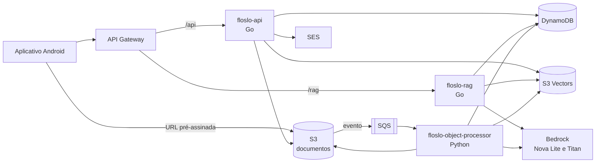

# Floslo

Aplicativo móvel que gera desafios de estudo a partir do material do próprio estudante e os apresenta no disparo de um alarme, que só é desligado depois que os desafios são concluídos.

Este repositório é o artefato de software do Trabalho de Conclusão de Curso descrito abaixo. Ele reúne o aplicativo, os serviços em nuvem e a infraestrutura como código.

## Sobre o trabalho

| | |
| :--- | :--- |
| **Título** | IA Generativa e Geração Aumentada por Recuperação na Personalização de Desafios Educacionais Integrados a Alarmes em Dispositivos Móveis |
| **Autor** | João Vitor Leal de Castro |
| **Orientador** | Prof. Me. Daniel Marques Gomes de Morais |
| **Curso** | Bacharelado em Sistemas de Informação |
| **Instituição** | Instituto Federal de Educação, Ciência e Tecnologia de São Paulo (IFSP), Campus São Paulo |
| **Ano** | 2026 |

O texto da monografia não faz parte deste repositório.

### Objetivo geral

Desenvolver um aplicativo móvel que gere, por meio de RAG (*Retrieval-Augmented Generation*), desafios educacionais a partir do material de estudo enviado pelo próprio estudante e os apresente no disparo de um alarme cuja desativação depende da resolução desses desafios, de modo a promover a prática ativa.

## Funcionalidades

- **Conta:** cadastro com aceite dos termos de uso e da política de privacidade, login por nome de usuário ou e-mail, redefinição de senha por código enviado ao e-mail e exclusão da conta com todos os dados.
- **Material de estudo:** envio de documentos em PDF, sugestão automática dos conceitos (tags) de cada documento, edição das tags e do nome, e exclusão do documento com seus vetores.
- **Agendadores:** dias da semana, horário, som, vibração, idioma dos desafios, documentos de origem e quantidade de itens de cada tipo de desafio.
- **Disparo:** o alarme toca mesmo com o aplicativo fechado e a tela bloqueada, e os desafios são gerados nesse momento. O alarme pode ser silenciado durante a resolução.
- **Desafios:** múltipla escolha, verdadeiro ou falso e descoberta (exposição de conteúdo), com o trecho do material que deu origem a cada um.
- **Acompanhamento:** histórico de disparos e de respostas, desempenho por conceito, atividade diária, erros recentes e sequência de dias de estudo.
- **Idioma:** interface em português ou inglês.

## Arquitetura

A solução segue uma arquitetura orientada a eventos, no modelo *serverless*, na região `us-east-1` da AWS.



| Função Lambda | Linguagem | Responsabilidade |
| :--- | :--- | :--- |
| `floslo-api` | Go | Conta, documentos, agendadores e URLs de envio. Rotas em `/api`. |
| `floslo-rag` | Go | Recuperação dos trechos e geração dos desafios. Rota `POST /rag/retrieve-and-generate`. |
| `floslo-object-processor` | Python | Extração de texto, divisão em trechos, tags e embeddings de cada documento. Acionada pela fila SQS. |

### Modelos de linguagem (Amazon Bedrock)

| Modelo | Uso |
| :--- | :--- |
| `amazon.titan-embed-text-v2:0` | Embeddings dos trechos e das consultas, com 1024 dimensões e distância de cosseno. |
| `amazon.nova-lite-v1:0` | Refinamento das tags e geração dos desafios. |

Os prompts estão em `api/processor/services/tag_refiner.py` e `api/internal/service/generation.go`.

### Ingestão de um documento

1. O aplicativo pede uma URL pré-assinada à `floslo-api` e envia o PDF direto ao S3.
2. O S3 publica o evento na fila SQS, que aciona a `floslo-object-processor`.
3. O documento é registrado no DynamoDB com o status `processing`.
4. O texto de cada página é extraído com pypdf, limpo e dividido em trechos de até 2000 caracteres, com sobreposição de 300. Trechos com menos de 50 caracteres são descartados.
5. Cada trecho recebe um embedding do Titan.
6. O YAKE extrai as candidatas a tag do documento inteiro, e o Nova Lite as refina em uma única chamada.
7. Os vetores são gravados no S3 Vectors, e o documento passa ao status `active`. Em caso de falha, passa a `failed`, com a mensagem de erro e um prazo de expiração.

PDFs digitalizados, sem texto extraível, não são aceitos, pois não há OCR.

### Geração dos desafios no disparo

1. O aplicativo chama `POST /rag/retrieve-and-generate` com o agendador e a data local, que também registra o dia de estudo.
2. A `floslo-rag` carrega o agendador e seus documentos e calcula quantos itens são necessários.
3. As tags dos documentos são usadas como consultas de busca semântica no S3 Vectors, filtradas por usuário e documento, com até 6 resultados por tag.
4. Os trechos são distribuídos entre os documentos e as páginas, e cada um ocupa uma vaga (*slot*) de desafio, com o trecho vizinho como apoio, quando existe.
5. O Nova Lite gera os itens em uma chamada por tipo de desafio. O item na posição *i* da resposta é ligado à vaga *i*, e assim cada desafio mantém a referência ao trecho de origem.
6. O aplicativo embaralha as alternativas, apresenta os desafios e grava as respostas no histórico local.

### Exclusão de um documento

A `floslo-api` apaga os vetores e o arquivo no S3, retira o documento dos agendadores vinculados e remove os seus registros no DynamoDB. Um agendador que fica sem documentos é desativado.

## Estrutura do repositório

```text
api/
  cmd/api, cmd/rag      Pontos de entrada das Lambdas em Go
  internal/             Handlers, serviços, repositórios, modelos e DTOs
  processor/            Lambda de processamento de documentos, em Python
  template.yml          Infraestrutura como código (AWS SAM)
  samconfig.toml        Parâmetros de implantação
mobile/
  src/app/              Telas e rotas (Expo Router)
  src/components/       Componentes de interface
  src/services/         Regras de negócio do aplicativo
  src/db/               Histórico local (SQLite)
  src/i18n/             Traduções em português e inglês
  modules/alarm-screen/ Módulo nativo Android para exibir o alarme sobre a tela bloqueada
  plugins/              Plugins de configuração do Expo
```

## Tecnologias

| Camada | Tecnologias |
| :--- | :--- |
| Aplicativo | React Native 0.86, Expo 57, TypeScript, Expo Router, NativeWind, TanStack Query, Notifee, expo-sqlite, i18next |
| Serviços em Go | Go 1.26, chi, AWS SDK for Go v2 |
| Processamento | Python 3.14, pypdf, YAKE, langdetect, boto3 |
| Infraestrutura | AWS SAM, Lambda, API Gateway (HTTP API), S3, S3 Vectors, SQS, DynamoDB, Bedrock, SES, SSM Parameter Store |

## Como executar

### Pré-requisitos

- Conta AWS, com AWS CLI e AWS SAM CLI configurados
- Go 1.26 e Python 3.14
- Node.js e npm
- JDK e Android SDK, para compilar o aplicativo Android

### Infraestrutura e serviços

Antes da primeira implantação, é necessário:

1. Liberar o acesso aos modelos Titan Text Embeddings V2 e Nova Lite no Amazon Bedrock, na região `us-east-1`.
2. Criar o segredo de assinatura dos tokens no SSM Parameter Store, com o nome `/lambda/floslo/jwt_secret`.
3. Verificar no Amazon SES a identidade usada no envio dos códigos de redefinição de senha.
4. Em outra conta, ajustar no `api/template.yml` os nomes dos *buckets*, que são únicos globalmente, o e-mail remetente e o ARN da identidade do SES.

Depois, para compilar e implantar:

```bash
cd api
make deploy
```

A URL da API fica na saída `ApiUrl` da pilha:

```bash
sam list stack-outputs --stack-name floslo --region us-east-1
```

### Aplicativo

```bash
cd mobile
make install
cp .env.example .env
```

Preencha `EXPO_PUBLIC_API_BASE_URL` no arquivo `.env` com a URL da API, sem barra no final.

| Comando | Descrição |
| :--- | :--- |
| `make start` | Inicia o servidor de desenvolvimento do Expo |
| `make android` | Compila e executa no dispositivo ou emulador Android |
| `make prebuild` | Gera o projeto nativo Android |
| `make build-apk` | Gera o APK de *release*, após o `make prebuild` |

O instalador para Android é publicado em [Releases](https://github.com/joaoleau/floslo/releases).

## Testes

```bash
cd api && go test ./...
cd api/processor && python -m unittest discover -s tests
cd mobile && make test
```

## Modelo de dados

### DynamoDB

Tabela única `floslo`, com a chave `PK` e `SK` e o índice secundário `GSI1`, usado na busca por nome de usuário.

| Entidade | PK | SK | Principais atributos |
| :--- | :--- | :--- | :--- |
| Usuário | `USER#<id>` | `PROFILE` | `username`, `email`, `password` (hash), `current_streak`, `last_active_date`, `terms_version`, `terms_accepted_at` |
| Busca por e-mail | `EMAIL#<email>` | `LOOKUP` | `user_id` |
| Documento | `USER#<id>` | `OBJECT#<id>` | `name`, `key`, `tags`, `language`, `vector_ids`, `status`, `error_message`, `ttl` |
| Agendador | `USER#<id>` | `SCHEDULER#<id>` | `name`, `language`, `weekdays`, `start_time`, `alarm_sound`, `vibration`, `sound_enabled`, `object_ids`, `challengers`, `enabled` |
| Vínculo documento e agendador | `USER#<id>` | `OBJECTLINK#<object_id>#SCHEDULER#<scheduler_id>` | Permite encontrar os agendadores de um documento sem percorrer a partição do usuário |
| Código de redefinição de senha | `USER#<id>` | `PWRESET` | `code_hash`, `expires_at`, `ttl` |

### S3 Vectors

Índice `floslo-index-v2`. Cada vetor representa um trecho e tem o id `vec_<object_id>_<página>_<índice do trecho>`, de modo que os trechos vizinhos são encontrados pela própria chave.

| Metadado | Descrição |
| :--- | :--- |
| `user` | Usuário dono do documento, usado como filtro de busca |
| `object_key` | Chave do documento no S3, usada como filtro de busca |
| `page` | Página de origem |
| `chunk_index` | Posição do trecho na página |
| `language` | Idioma do documento |
| `chunk` | Texto do trecho |

### Aparelho

O histórico de sessões e de respostas fica somente no celular, em um banco SQLite, e não é enviado aos servidores.

## Dados e privacidade

Os dados enviados ao Floslo ficam na AWS, em `us-east-1`, nos Estados Unidos. O aceite dessa transferência internacional, prevista na LGPD, é pedido no cadastro, e os termos completos estão no próprio aplicativo. O conteúdo dos desafios é gerado por IA e pode conter erros, por isso cada desafio traz o trecho de origem para conferência.

## Uso de inteligência artificial no desenvolvimento

Em atendimento ao Art. 13 do Regulamento do TCC do curso, a monografia traz uma declaração completa de uso de IA. No desenvolvimento do software, o Claude Code, da Anthropic, apoiou a escrita e a revisão de código, a criação de testes automatizados, a depuração de erros e a configuração da infraestrutura como código. As decisões de projeto são do autor, que revisou, testou e integrou todo o código.
